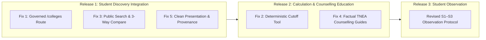

# TN Engineering Guidance — Product Improvement Proposal V1 (Revised)

**Document ID:** `PROP-2026-001-REV1`  
**Status:** `APPROVED_WITH_MANDATORY_REVISIONS`  
**Project Control State:**
* `PRODUCT_DIRECTION = ACCEPTED`
* `FIX_1 = APPROVED_WITH_SAFEGUARDS` (P1)
* `FIX_2 = REVISE` (P1)
* `FIX_3 = APPROVED_WITH_SAFEGUARDS` (Elevated to P1)
* `FIX_4 = REVISE` (P1 — Factual Safety)
* `FIX_5 = APPROVED_WITH_SAFEGUARDS` (P1)
* `S1_S3_PROTOCOL = REVISE`
* `IMPLEMENTATION_AUTHORIZED = NO` (Awaits Release 1 scope signoff)
* `REAL_STUDENT_VALIDATION = NOT_RUN`
* `M5_HISTORICAL_EXPANSION = DEFERRED`

---

## 1. Executive Summary & Grounding

This document updates `PROP-2026-001` with mandatory owner corrections following verification against official TNEA 2026 documentation.

The core diagnosis remains firm:
* The project has established strong, bilingual beginner guidance and ingested governed 2026 college data (389 colleges, 3,128 offerings).
* However, the ordinary student experience currently sequesters that governed directory behind internal preview gates (`/internal/m4-pilot`), leaving students in synthetic review fixtures or navigation dead ends.
* All five improvements are approved in principle, reorganized into **three bounded releases** that enforce strict admission-fact safety, reuse accepted M4 engines, and eliminate misleading or simplified counselling claims.

---

## 2. Reorganized Implementation Strategy (Three Bounded Releases)

---

## 3. Detailed Fix Specifications & Mandatory Safeguards

### Release 1: Student Discovery Integration (Fixes 1, 3, 5)

#### Fix 1: Connect Governed M4 Directory to the Ordinary Student Journey
* **Public Route:** Expose `/colleges` as the primary public catalog, directly linked from branch explanations and personal guidance.
* **Exact Wording:** The branch-to-college handoff button must use:
  > **"இந்தப் பாடப்பிரிவு உள்ள கல்லூரிகளைப் பார்க்க"** *(View colleges with this branch)*  
  *(Avoid phrasing like "in our pilot directory" or any implication of admission guarantee).*
* **Safeguards & Invariant Governance:**
  * Reuses accepted M4 application logic and data pipelines (`src/ui/m4-governed-pilot.ts`).
  * Preserves the approved 389-college, 3,128-offering scope from 2026 source listings.
  * Preserves exact programme identities, canonical associations, and unresolved holds.
  * Seat vacancy facts remain explicitly marked as `UNKNOWN_OR_UNPUBLISHED` (never assumed or defaulted to zero).
  * Prominently displays evidence limits: a listing confirms that an offering was recorded in the 2026 source, not that seats currently exist or that an individual is admitted.

#### Fix 3: Surface Public Search, Filtering, and 3-Way Comparison
* **Elevation:** Elevated to **P1** alongside Fix 1 so the public directory is immediately usable.
* **Mechanism:** Reuse the existing `SEARCH_ALIASES` dictionary (`cse`, `ece`, `aids`, `mech`, `govt`, `psg`, `cit`, `gct`) and district filters already present in `m4-governed-pilot.ts`.
* **Factual Comparison Invariants:**
  * Displays verified college type, verified district, and verified source-listed programmes only.
  * Unknown attributes must remain explicitly unknown.
  * Bounded strictly to 3 options (`uniquePicks.slice(0, 3)`).
  * **Strict Negative Rule:** Never introduce arbitrary college scores, quality rankings, recommendation algorithms, or admission probabilities.

#### Fix 5: Student-Centric Presentation & Truthful Labeling
* **Presentation Cleanup:** Eliminate internal developer jargon (`Owner review`, `D0/D1`, `Slice 7`, `Pilot runtime`) from all student-facing routes.
* **Honesty Invariant (No False Re-labeling):**
  * Real governed data must be presented clearly in student-friendly Tamil and English with precise source references.
  * **Synthetic examples must remain explicitly identified as fictional demonstration models wherever they appear.** Fictional fixtures must never be quietly renamed to sound like real institutions.
  * "Verified against official listings" applies only to facts specifically checked against official 2026 publications.

---

### Release 2: Calculation & Counselling Education (Fixes 2, 4)

#### Fix 2: Deterministic Cutoff Arithmetic Tool
* **Formula:** Academic-stream arithmetic demonstration for standard 100-point scale:
  $$\text{Cutoff} = \text{Maths} + \frac{\text{Physics} + \text{Chemistry}}{2}$$
* **Placement:**
  * `/personal`: Full interactive calculator using existing deterministic calculation authority.
  * `/beginner?section=admission`: Static educational example with an explicit link to `/personal`.
* **Mandatory Educational Correction:**  
  Cutoff is for **merit ranking**, not qualifying eligibility (which has separate minimum percentage rules and normalization provisions).
* **Approved Student-Facing Tamil Copy:**
  > **"இது உங்கள் பாட மதிப்பெண்களிலிருந்து கணக்கிடப்பட்ட கட்-ஆஃப் மதிப்பு. இதுவே முழுமையான சேர்க்கைத் தகுதியையோ, அதிகாரப்பூர்வ தரவரிசையையோ, கல்லூரி இடம் கிடைப்பதையோ உறுதி செய்யாது."**  
  *(This is the cutoff score calculated from your subject marks. This alone does not establish complete admission eligibility, official rank, or a college seat).*
* **Next Action:** Links to general college exploration (`/colleges`), never to cutoff-based prediction or probability filtering.

#### Fix 4: Factual TNEA Counselling Guidance
All educational content must align strictly with official TNEA 2026/DOTE procedures.

1. **Choice Ordering:**
   * Explain neutrally that seat allotment proceeds strictly based on candidate rank, reservation community, seat matrix, and preference order.
   * Avoid absolute claims like *"automatically locks the highest matching choice"*; explain that the algorithm evaluates choices sequentially from Choice 1 downward, allotting the highest preference where a vacancy is available.
2. **Accept & Upward Movement:**
   * Clarify that a candidate retains their earlier allotment only when all mandatory reporting, fee payment, and confirmation requirements at TFC/college are fulfilled within the stipulated deadline.
3. **Decline & Upward Movement:**
   * Clarify that the candidate explicitly relinquishes their current allotment.
   * Correct the "no fallback" statement: note that if upward movement does not produce a higher preference, the candidate is not allotted a seat in that round but may be eligible to participate in subsequent rounds per TNEA counselling rules.
4. **7.5% Government School Quota:**
   * Require study from Standards 6 to 12 in Tamil Nadu Government schools.
   * State that bonafide certificate verification is conducted at TNEA Facilitation Centres (TFC).
   * **Do not publish universal countersignature requirements (e.g. BEO/CEO) unless confirmed by the official 2026 brochure.**

---

### Release 3: Revised S1–S3 Student Observation Protocol

Student comprehension must be verified through structured observation, not assumed from passing automated test suites.

| Scenario | Objective | Revised Task Protocol | Success Criteria |
| :--- | :--- | :--- | :--- |
| **S1: Zero-Knowledge Student** | Orientation & Awareness | Enter Home $\rightarrow$ explore what engineering involves $\rightarrow$ view a branch profile $\rightarrow$ identify next direction. | Articulates what engineering is in their own words; identifies difference between two disciplines; finds next action without needing marks. |
| **S2: Branch Explorer** | Branch-to-College Discovery | Start at a branch profile $\rightarrow$ click `"இந்தப் பாடப்பிரிவு உள்ள கல்லூரிகளைப் பார்க்க"` $\rightarrow$ use district/type filter $\rightarrow$ observe missing vacancy. | Successfully reaches offering colleges; correctly interprets college type; understands that an offering does not guarantee seat vacancy. |
| **S3: Knows Marks / Counselling** | Realistic Evaluation & Procedure | Input marks $\rightarrow$ observe cutoff $\rightarrow$ review Accept & Upward vs Decline & Upward guidelines. | Correctly distinguishes cutoff from complete eligibility; explains consequences and reporting duties for upward movement choices. |

#### Recorded Observational Metrics:
* Task completion rate (unassisted vs assisted).
* Specific points of hesitation, confusion, or terminology friction.
* Misconceptions regarding cutoff vs guaranteed admission.
* Mobile responsiveness usability on physical handsets.

---

## 4. Implementation Status & Delivery Summary

| Milestone | Fix Scope | Delivered Capabilities | Verification Status |
| :--- | :--- | :--- | :---: |
| **Release 1** | **Fix 1, Fix 3, Fix 5** | • Public `/colleges` directory route registered unconditionally. • 2026 TNEA source provenance notice displayed with explicit vacancy bounds. • Branch-to-college handoff copy: `"இந்தப் பாடப்பிரிவு உள்ள கல்லூரிகளைப் பார்க்க"`. • Site nav header and home landing cards connected to directory. | **COMPLETED & PASSING** (328 tests) |
| **Release 2** | **Fix 2, Fix 4** | • Interactive deterministic cutoff calculator on `/personal` ($M + (P+C)/2$). • Mandatory Tamil & English educational disclaimer (cutoff for merit ranking, not admission guarantee). • Static cutoff walkthrough on `/beginner?section=admission` linking to calculator. • Factual counselling guidance on `/counselling` (sequential Choice 1..N order, Accept & Upward conditions, Decline & Upward round retention, 7.5% Govt quota continuous Std 6–12 verified at TFC). | **COMPLETED & PASSING** (331 tests) |
| **Release 3** | **Observation Protocol** | Bounded S1–S3 student observation protocol with 3–5 real students on physical mobile handsets. | **READY TO PROCEED** |
