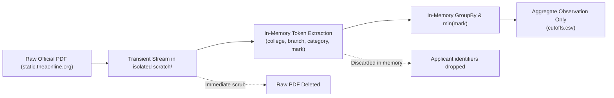

# M5-D5 — Derived Metric Methodology and Ephemeral Privacy Specification

Status: **PROPOSED FOR OWNER REVIEW** (2026-11-06).
Authority: [Accepted M5-T01 Contract](m5_contract_spec_v1.md), [Accepted M5-T02 Assessment](m5_source_census_v1.md), [M5 Execution Proposal](m5_decision_support_proposal_v1.md).
Governing Decision: Owner resolved the aggregate-cutoff source blocker by authorizing this D5 specification to govern derivation from official provisional allotment publications.

---

## 1. Purpose and Scope

Because the official cutoff portal (`cutoff.tneaonline.org`) is currently inaccessible (HTTP 503) and no official static closing-cutoff aggregate summary is published by the Directorate of Technical Education (DoTE), this specification establishes:
1. **The mathematical and semantic derivation rule** for computing representative closing cutoff metrics from official Round 1–3 provisional allotment lists (`static.tneaonline.org`).
2. **The ephemeral clean-room privacy architecture** guaranteeing that zero applicant-level personal identifiers (names, application numbers, individual ranks, row records) are retained, stored, or committed.
3. **The semantic qualification and disclosure rules** ensuring students are never misled into treating a provisional allotment minimum as a final sanctioned closing guarantee.

This specification does **not** authorize statewide ingestion, production application implementation, or student-facing release.

---

## 2. Derivation Methodology (`D5-PROVISIONAL-ALLOTMENT-MIN-V1`)

### A. Raw Source Target
* **Publisher:** Tamil Nadu Engineering Admissions (TNEA) / Directorate of Technical Education (DoTE).
* **Domain:** `static.tneaonline.org/docs/`.
* **Eligible Documents:** Official General Academic and Government School 7.5% Academic provisional allotment PDF publications for candidate historical years (2024 and 2025), specifically Rounds 1, 2, and 3.

### B. Grouping and Aggregation Rule
For each target admission year and counselling route (General Academic and 7.5% quota evaluated strictly independently):

$$\text{Bucket Key} = (\text{college\_code}, \text{programme\_code}, \text{allotted\_category}, \text{counselling\_round}, \text{academic\_year})$$

Where:
* `college_code`: Exact 4-digit source string (e.g., `"2722"`, `"0001"`). No numeric truncation.
* `programme_code`: Exact 2-letter source string (e.g., `"CS"`, `"EC"`).
* `allotted_category`: Exact allotted community column value (`"OC"`, `"BC"`, `"BCM"`, `"MBC"`, `"SC"`, `"SCA"`, `"ST"`). Allotted category is strictly distinguished from applicant community.
* `aggregate_mark`: Normalized merit mark out of 200.00 ($\text{Maths} + \frac{\text{Physics} + \text{Chemistry}}{2}$).

The closing cutoff metric for each bucket is derived deterministically as:

$$\text{closing\_cutoff} = \min_{i \in \text{Allotted}}(\text{aggregate\_mark}_i)$$

### C. Observation Classification
In accordance with the [M5-T01 schema](m5_contract_spec_v1.md#L35):
* `observation_basis` = `DERIVED`
* `derivation_method_version` = `"D5-PROVISIONAL-ALLOTMENT-MIN-V1"`
* `metric_type` = `CUTOFF_SCORE`
* `metric_unit` = `SCORE_200`
* `cutoff_status` = `REPORTED` (if $\ge 1$ allotted student in bucket) or `NOT_REPORTED` (if 0 allotted students in bucket)
* `closing_rank` = `null` (rank comparison is strictly excluded from the first slice)
* `publication_status` = `PROVISIONAL`

---

## 3. Ephemeral Clean-Room Privacy Architecture

To comply strictly with M5-T01 Section 6 (*Zero applicant-level names, application numbers, dates of birth, individual ranks or row-level records in repository files, manifests, extracted datasets, logs, screenshots or product derivatives*):



### Mandatory Execution Protocol
1. **Isolated Scratch Workspace:** Any transient downloading occurs strictly in `<conversation>/scratch/m5-t04-transient/`. This directory is strictly ignored by Git and never committed.
2. **In-Memory Streaming & Transformation:** The extraction script reads tabular streams page-by-page. It captures only the tuple `(college_code, programme_code, allotted_category, aggregate_mark)`.
3. **Immediate Dropping of Identifiers:** Columns for `S.No`, `Application Number`, `Applicant Name`, `Applicant Community`, and `Rank` are discarded in memory at the row parse stage. They are never written to any intermediate text, JSON, or CSV file.
4. **Immediate Deletion of Raw Artifacts:** Upon completion of bucket aggregation, the downloaded raw PDF is immediately deleted from the scratch directory.
5. **Persisted Output Constraint:** The only persisted output is the aggregate observation record:
   ```csv
   observation_id,college_code,programme_code,year,round,route,category,closing_cutoff,cutoff_status,observation_basis,derivation_method_version,source_url,pdf_page_range
   ```
6. **Accidental Capture Response:** If an applicant identifier is detected in any output artifact, processing halts immediately, all output files are purged, and the extraction logic is corrected before re-running.

---

## 4. Semantic Disclosures and Student Copy Rules

Because a minimum observed provisional allotment does not account for later counselling dynamics, the UI and documentation must enforce the following truth-in-guidance disclosures:

1. **Explicit Qualification:**
   * **English:** *"Derived from official Round {round} provisional allotment records. Does not reflect upward movement, reporting dropouts, or supplementary rounds."*
   * **Tamil:** *"அதிகாரப்பூர்வ சுற்று {round} தற்காலிக ஒதுக்கீட்டுப் பதிவுகளிலிருந்து பெறப்பட்டது. இது மேல்நோக்கிய நகர்வு (upward movement) அல்லது இறுதி சேர்க்கை மாற்றங்களைக் கணக்கில் கொள்ளாது."*
2. **Prohibited Interpretations:**
   * Never describe a derived value as an "Official Closing Cutoff" without the qualifier "Provisional Allotment Minimum."
   * Never infer admission probability, chance, or safe status based on a positive delta ($\text{student\_cutoff} > \text{historical\_cutoff}$).
   * Never compare across routes (General Academic cutoffs must never be shown to a student seeking 7.5% quota comparison, or vice-versa).

---

## 5. Candidate Validation Cohort (Gate A Scope)

When authorized under M5-T03/T04, this methodology will be executed on a bounded sample strictly observing the T01 ceilings:
* **Colleges Ceiling:** At most 10 governed institutions from the accepted 2026 directory.
* **Pairs Ceiling:** At most 20 exact college–programme pairs.
* **Candidate Institutions:**
  1. `2722` — Sri Krishna College of Technology (Autonomous, Coimbatore)
  2. `0001` — University Departments of Anna University, CEG Campus (Chennai)
  3. `0004` — University Departments of Anna University, MIT Campus (Chromepet)
  4. `1304` — Easwari Engineering College (Autonomous, Chennai)
  5. `2005` — Government College of Technology (GCT, Coimbatore)
  6. `2603` — Government College of Engineering, Bargur (Krishnagiri)
  7. `3018` — University College of Engineering, Thirukkuvalai (Nagapattinam)
  8. `4967` — S. Veerasamy Chettiar College of Engineering and Technology (Tenkasi)

---

## 6. Review Gates and Next Actions

1. **Owner Review:** Ganesan reviews this D5 specification to approve the derivation formula, clean-room privacy protocol, and semantic disclosures.
2. **T03 Authorization:** Upon D5 approval, authorize M5-T03 to audit and lock the exact candidate cohort of up to 10 colleges and 20 pairs across 2024 and 2025.
3. **T04 Authorization:** Authorize the bounded extraction experiment under the clean-room protocol in an isolated scratch environment.
