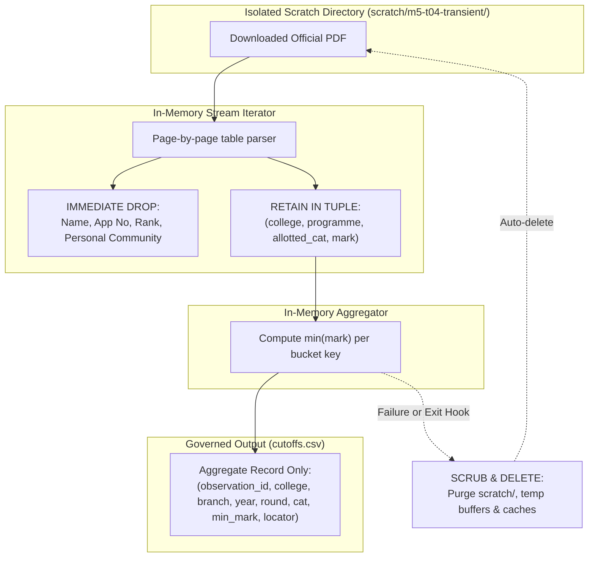

# M5-D5 — Derived Metric Methodology and Ephemeral Privacy Specification

Status: **PROPOSED FOR OWNER REVIEW** (2026-11-06).
Base: `51bb945bb4b2b591ba528b5b7885ffec9583e9bb`.
Authority: [Accepted M5-T01 Contract](m5_contract_spec_v1.md), [Accepted M5-T02 Assessment](m5_source_census_v1.md), [M5 Execution Proposal](m5_decision_support_proposal_v1.md).
Governing Context: The official cutoff portal (`cutoff.tneaonline.org`) remains unavailable (HTTP 503). This specification proposes an alternative evidence method to derive historical observation candidates from official provisional allotment publications. Competitor practices (e.g. TNEAhelp) provide context on data availability only; they do not constitute project authority.

Acceptance of this D5 specification approves the methodology and privacy controls only. It does **not** authorize production ingestion, application implementation, merge, deployment, or automatic execution of T03/T04.

---

## 1. Meaning and Semantic Boundary

1. **Precise Metric Identity:**
   The output of this method is formally defined as the:
   > **“Minimum observed mark in the specified provisional allotment publication”**
2. **Prohibited Equivalence:**
   * It is **not** an “official closing cutoff.”
   * It is **not** an official minimum admission threshold, entitlement, or eligibility guarantee.
   * It represents an observed statistical minimum among candidates allotted in a specific dated provisional publication.
3. **Metric Classification:**
   * `metric_type` = `CUTOFF_SCORE`
   * `metric_unit` = `SCORE_200`
   * `observation_basis` = `DERIVED`
   * `derivation_method_version` = `"D5-PROVISIONAL-ALLOTMENT-MIN-V1"`
   * `publication_status` = `PROVISIONAL`
   * `closing_rank` = `null` (rank comparison remains strictly excluded from the first slice)

---

## 2. Source Scope and Grouping Semantics

### A. Target Official Sources
* **Publisher:** Tamil Nadu Engineering Admissions (TNEA) / Directorate of Technical Education (DoTE).
* **Location:** Official `static.tneaonline.org/docs/` repository.
* **Eligible Documents:** Round 1, Round 2, and Round 3 provisional allotment lists for General Academic and Government School 7.5% Academic for candidate years 2024 and 2025.

### B. Grouping Dimensions
Every derived observation must be strictly partitioned across all eight dimensions:

$$\text{Bucket Key} = (\text{year}, \text{stream}, \text{route}, \text{stage}, \text{round}, \text{college\_code}, \text{programme\_code}, \text{allotted\_category})$$

| Dimension | Permitted Values and Semantics |
| :--- | :--- |
| `year` | `2024` or `2025` (explicit source year; no year-averaging or synthetic trend). |
| `stream` | `ENGINEERING_ACADEMIC` |
| `route` | `GENERAL_ACADEMIC` vs `GOVT_SCHOOL_7_5` (strictly isolated; zero cross-substitution). |
| `stage` | `PROVISIONAL_ALLOTMENT` |
| `round` | `ROUND_1`, `ROUND_2`, or `ROUND_3` |
| `college_code` | Literal 4-digit source string (e.g. `"2722"`, `"0001"`). No numeric truncation. |
| `programme_code` | Literal 2-letter source string (e.g. `"CS"`, `"EC"`). |
| `allotted_category` | `"OC"`, `"BC"`, `"BCM"`, `"MBC"`, `"SC"`, `"SCA"`, `"ST"`. Allotted category is strictly distinguished from applicant community. `OC` is an allotment quota, never an applicant community. |

### C. Mathematical Derivation
For each non-empty bucket:

$$\text{closing\_cutoff} = \min_{i \in \text{Bucket}}(\text{aggregate\_mark}_i)$$

Where $\text{aggregate\_mark}$ is normalized Class 12 merit score out of 200.00 ($\text{Maths} + \frac{\text{Physics} + \text{Chemistry}}{2}$).

---

## 3. Completeness, Failures, and Scope Limits

To prevent generating unjustified or falsely elevated minimums from incomplete extractions:

1. **Document-Level Integrity:**
   * Before parsing, verify that the PDF has a valid EOF marker, non-zero byte size, and matches expected page counts.
   * If any page in the target PDF fails rendering, decryption, or table extraction, the entire document extraction is flagged `EXTRACTION_FAILED`.
2. **Bucket-Level Completeness:**
   * If extraction fails on any page containing rows for a target `(college_code, programme_code)`, the closing cutoff for that bucket must be marked `NEEDS_REVIEW`, and no numerical value is emitted.
   * Tabular row structures must match the expected column count. Any row with shifted or unparseable columns aborts derivation for that institution–round.
3. **Empty Buckets (`NOT_REPORTED`):**
   * If an approved directory pair has zero allotted students in a category for a given round, the status is `NOT_REPORTED`.
   * An empty bucket must **never** be populated with `0.0`, an arbitrary baseline, or a pass mark (e.g. 40%).
4. **Scope Gaps and Cancellations:**
   * Withdrawn allotments, cancelled seats, or special supplementary rounds not in the primary list are not inferred.
   * Missing rounds remain `UNKNOWN`.

---

## 4. Timing and Upward Movement Semantics

Provisional allotment lists represent a point-in-time snapshot during counselling. Timing claims must be factually supported:

1. **Source-Faithful Stage Description:**
   * The qualifier **“before upward movement”** may be used **only** where the official schedule or document heading explicitly defines that stage (e.g. initial Round 1 provisional lists).
   * Where a later round list (e.g. Round 2 or Round 3) incorporates upward movement from earlier rounds, or where the source text does not state the upward movement relationship, do not make an unevidenced stage claim.
2. **Mandatory Truth-in-Guidance Copy:**
   * **General Disclosure:**
     > *“Minimum observed mark in the official {year} Round {round} provisional allotment publication. Subsequent candidate reporting confirmation, fee payment non-reporting, upward movement, and later counselling rounds are not reflected.”*
   * **Tamil Equivalence:**
     > *“அதிகாரப்பூர்வ {year} சுற்று {round} தற்காலிக ஒதுக்கீட்டுப் பதிப்பில் காணப்பட்ட குறைந்தபட்ச மதிப்பெண். மாணவர் சேர்க்கை உறுதிப்படுத்தல், கட்டணம் செலுத்தாமை, மேல்நோக்கிய நகர்வு (upward movement) மற்றும் பிந்தைய சுற்று மாற்றங்கள் இதில் கணக்கில் கொள்ளப்படவில்லை.”*
3. **Prohibited Claims:**
   * Must not imply that obtaining a score equal to or greater than the observed minimum guarantees admission or allotment.

---

## 5. End-to-End Operational Privacy Architecture

“In-memory processing” alone is insufficient without concrete lifecycle boundaries. The extraction pipeline must enforce strict controls across files, memory, logs, caches, and failures:

1. **Storage Isolation:**
   * Raw PDF artifacts reside strictly in `<workspace>/scratch/m5-t04-transient/`.
   * This directory is git-ignored, excluded from manifests, and isolated from production code.
2. **Immediate Token Filtering:**
   * The parser iterates line-by-line across PDF tables.
   * Columns for `S.No`, `Application Number`, `Applicant Name`, `Applicant Community`, `General Rank`, and `Government Rank` are dropped immediately at the row-unpack step.
   * They are never stored in lists, DataFrames, dictionaries, or intermediate JSON/CSV files.
3. **Zero Personal Data in Logs or Stack Traces:**
   * Log statements record aggregate counts only (e.g. `Inspected page 42; 28 candidate rows parsed`).
   * Exception handlers must catch parsing errors without printing the raw line text, preventing accidental logging of applicant names or IDs.
4. **Failure and Exit Clean-up:**
   * The extraction harness uses `try...finally` constructs and `atexit` handlers.
   * Whether the script succeeds, fails, or is cancelled, all downloaded PDFs, OS temp files, and parser buffers in the scratch directory are immediately deleted.
5. **Accidental Capture Protocol:**
   * If any applicant identifier is detected in an output artifact, processing halts immediately, all output files are purged, and the extraction logic is corrected before re-running.

---

## 6. Sample Validation Ledger Requirements (Before Approval)

No derived dataset may be approved or ingested into product directories without a completed **Validation Ledger**:

1. **Visual Spot-Check Ratio:**
   * At least 10% of derived buckets—and at least one bucket per candidate college—must be manually checked against the visual PDF page.
   * Record the exact PDF filename, visual PDF page number, table row index, and confirmed minimum mark.
2. **Ledger Audit Fields:**
   * `source_sha256`: Hash of source PDF prior to transient processing.
   * `total_pages_inspected`: Integer count.
   * `total_rows_parsed`: Integer count.
   * `error_count`: Number of extraction anomalies encountered.
   * `derivation_method_version`: Must equal `"D5-PROVISIONAL-ALLOTMENT-MIN-V1"`.
3. **Approval Boundary:**
   * Owner reviews the validation ledger before any derived record is promoted to `data/cutoffs.csv`.
   * Derived records must never overwrite or delete historical M0–M4 data.

---

## 7. Decoupled Task Sequencing & Governance

1. **D5 Acceptance Gate:**
   * Owner reviews and accepts/revises this specification.
   * Acceptance of D5 does **not** authorize T04 extraction.
2. **M5-T03 Independent Cohort Audit:**
   * T03 identity research (auditing 10 candidate colleges and 20 exact pairs across 2024–2026 catalogues for name/code continuity) does **not** require applicant data and may be authorized independently.
3. **M5-T04 Extraction Experiment Authorization:**
   * T04 requires its own distinct authorization following T03 cohort approval and D5 validation.
